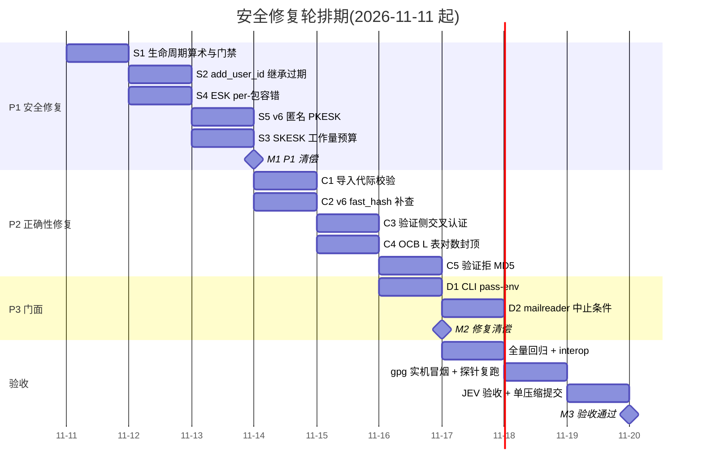
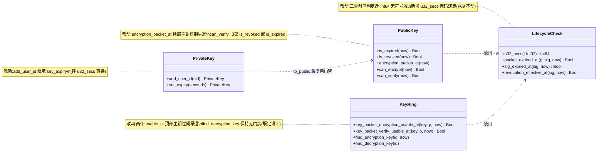
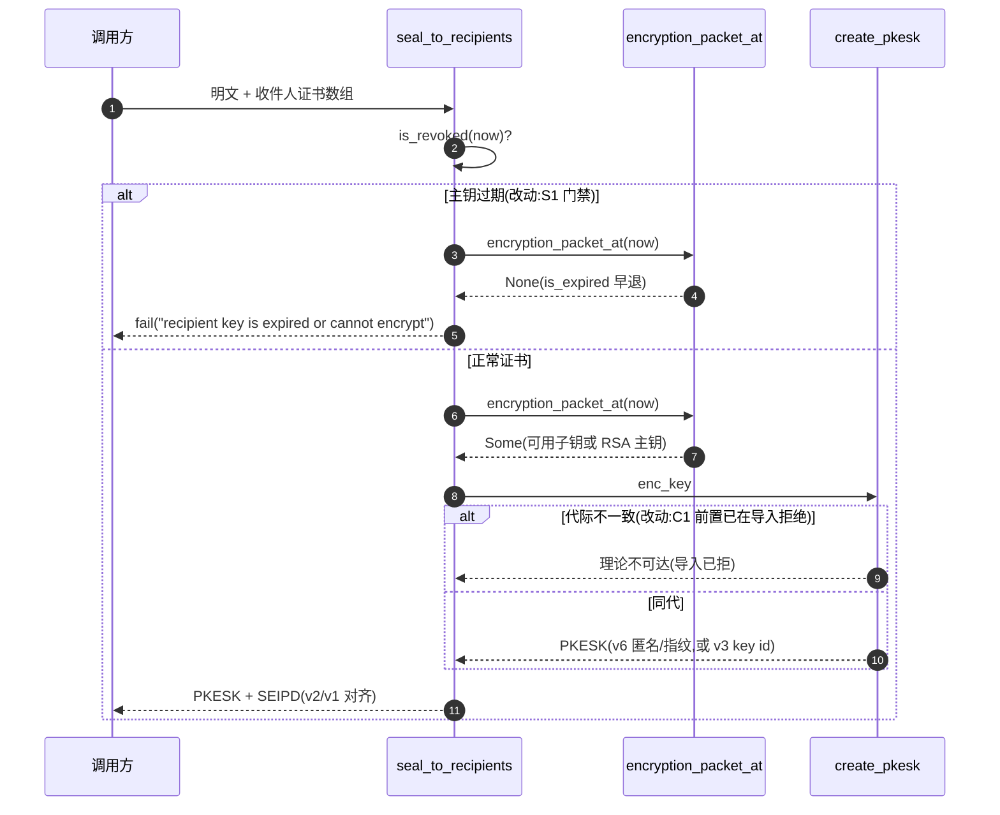
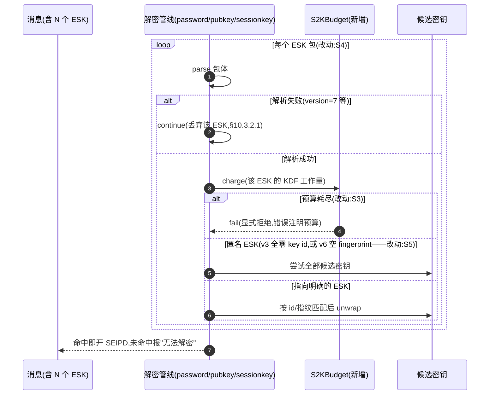
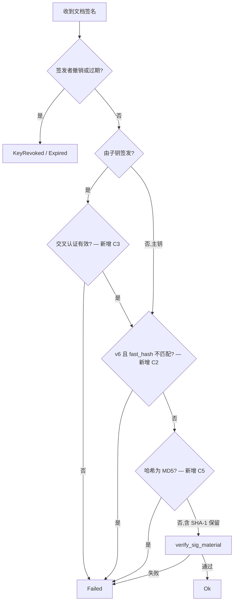

# 安全修复轮计划(2026-11-10)

本文档是本轮唯一修复计划,吸收并取代同日早先的生命周期修复计划(其 F1–F5 并入本计划
S1–S4,原文件已删除以避免双计划漂移)。范围:生命周期审查轮 2 条 + 三 agent 重审轮 10 条,
全部已经过静态核实、2 条探针实锤、JEV 独立核验 18 题全过。修完删除本文件。

## 一、审查报告(证据链汇总)

**证据链**:subagent 逐行审计(三盲区)→ 逐条静态核实 → 行为级发现探针实锤(native 实机)
→ JEV 概率核验(noul 0.913–0.999,无一复议)。无一条被推翻。

| 统一编号 | 缺陷 | 位置 | 严重度 | 实证 |
|---|---|---|---|---|
| S1-a | 主钥过期仍可经子钥加密(加密路径漏主钥过期门禁,验证侧 N7 已有) | api/lifecycle.mbt:202/234;api/keyring.mbt:54/77 | P1 安全 | 探针实锤;JEV 0.990 |
| S1-b | 过期算术 Int32 回绕/负解析,合法长有效期自毙 | api/lifecycle.mbt:50/67/134;packet/sig.mbt:588 | P1 可用性 | 探针实锤(15.8年/68年);JEV 0.913–0.921 |
| S2 | add_user_id 重认证首个 UID 静默丢弃 Key Expiration Time → 过期主钥永久续命 | api/user_id.mbt:155;api/key_signing.mbt:233 | P1 安全 | 探针实锤(true→false);JEV 0.989 |
| S3 | SKESK 重试循环 × 攻击者选定 S2K 工作因子,无跨包累计预算 → KB 级消息换分钟级预认证 CPU | api/password.mbt:329;api/sessionkey.mbt:138;s2k/s2k.mbt:70 | P1 DoS | 静态确认;JEV 0.992 |
| S4 | 无法解析的 ESK 包中止整条解密(违反 RFC 9580 §10.3.2.1 MUST discard) | api/pubkey.mbt:319;api/password.mbt:331;api/sessionkey.mbt:161 | P1 可用性 | 探针实锤(3 字节毒化整条);JEV 0.957 |
| S5 | v6 匿名 PKESK(size=0,§5.1.2 合法)被 pkesk_is_anonymous 永久跳过 → 隐藏接收者解不开 | api/pubkey.mbt:274 | P1 可用性 | 静态确认 + RFC 原文;JEV 0.968 |
| C1 | 导入不强制 v6 主钥⇔v6 子钥代际一致(生成侧有守卫)→ 加密产出 Table 26 违规、无人能解的消息 | api/key_codec.mbt:405;api/pubkey.mbt:121/31-59 | P2 | 静态确认;JEV 0.979 |
| C2 | verify_key_signature 不查 v6 fast_hash(文档签名路径已查)→ 违反 §5.2.4 MUST | api/key_signing.mbt:546 | P2 合规 | 静态确认;JEV 0.993 |
| C3 | 验证路径接受未交叉认证签名子钥(签发侧硬性要求,gpg 拒收) | api/sign.mbt:496-514 | P2 | 静态确认;JEV 0.991 |
| C4 | OCB L 表按块数线性分配(需 ~28 项实分 6.7×10⁷ 项)→ 大消息 ~4× 内存放大,且在解压闸门之前 | cipher/ocb.mbt:43/126/233 | P2 DoS | 静态确认;JEV 0.990 |
| C5 | v4 验证接受 MD5/SHA-1 签名(v6 经 salt 表已封)→ 与 gpg 门禁分歧 | api/sign.mbt:527;primitives/hash.mbt:30 | P2 加固 | 静态确认;JEV 0.989 |
| D1 | CLI 口令经 argv 透传(encpass/decpass/lock/unlock),与仓库示例 --pass-env 风格不一致 | cmd/main/main.mbt:57-76/143-160 | P3 | 静态确认;JEV 0.999 |
| D2 | mailreader 对 KeyRevoked/Expired 不中止、退出码 0 → 被撤销签名邮件静默归档 | example/mailreader/main.mbt:368 | P3 | 静态确认;JEV 0.988 |

**根因归类**:"同一安全决策只在单侧路径有门禁"的不对称类 5 条(S1-a、S2、C1、C2、C3),
数值/位宽类 2 条(S1-b 及其衍生),预算缺失 1 条(S3,对照解压侧已有累计 budget),
规范合宽容错 2 条(S4、S5),门面 2 条(D1、D2)。不对称类是历轮漏检的结构性原因,
本轮修复后每处门禁必须在两类测试里各有一条对角断言(正向拒绝 + 反向不误伤)。

**明确不做(有注释的既定设计或过度设计)**:解密侧 `find_decryption_key` 保持无生命周期
门禁(过期前收到的信件仍可解);`Reader::read_u32` 的 F09 二补数约定不动(修在解释层);
`key_expiration_body` 写守卫不收窄(S1-b 修后读侧全域可解释);OCB/tag-20 消息长度闸门不做
(修 C4 后内存放大已消除,闸门会误伤合法大文件);SHA-1 验证保留(旧邮件兼容,gpg 对
旧签名同样宽限),只拒 MD5。

## 二、修复项详单

### S1 生命周期算术与门禁(api/lifecycle.mbt、api/keyring.mbt)
- 新增私有助手 `fn u32_secs(t : Int32) -> Int64 { t.to_int64() & 0xFFFFFFFFL }`。
- `packet_expired_at`(:50)、`sig_expired_at`(:67)改为 Int64 无符号域求和比较;
  `revocation_effective_at`(:134)改为 `u32_secs(created) <= now`。
- `encryption_packet_at`(:202)顶部加 `if self.is_expired(now) { return None }`;
  `can_verify`(:245)改 `is_revoked(now) || is_expired(now)`;
  keyring 两个 `usable_at`(:54/:77)顶部同加 `key.is_expired(now)` 早退。
- 测试:过期主钥+有效子钥 → can_encrypt=false、encryption_packet_at=None、
  find_encryption_key=None、encrypt_to_recipients 报错;反向(主钥未过期)全可用;
  set_expiry(5亿秒) 创建当下不过期、过期点后 1 秒过期(armor 往返断言);
  set_expiry(2³¹) 读回 2147483648;can_verify 对齐断言;未来撤销(2106 落款)到时前不生效。

### S2 add_user_id 继承 Key Expiration Time(api/user_id.mbt)
- `let flags = ...` 处同步读取 `self.self_signature()` 的 key_expiration_time,
  经 `u32_secs` 转换后传 `make_self_signature(..., key_expiry=...)`。
- 测试:重认证首个 UID 后 is_expired 保持 true(主用例)+ 追加式对照 + v6 direct 兜底对照
  + 继承值与原值相等断言(白盒查子包)。

### S3 SKESK 工作量预算(api/password.mbt、api/sessionkey.mbt、s2k/)
- 新增私有 `S2KBudget`(参 S03 解压 budget 模式):每条消息上限
  `MAX_ESK_ATTEMPTS = 16`、KDF 累计预算 = 8 次满配 Argon2(t=3, m=64MiB)等效工作量
  (Argon2 记 t×m,iterated S2K 记 count;常量入 README 数字声明核对)。
- 三个解密循环共享同一 budget;超限 `@error.fail`(显式拒绝,与一致性轮"静默改显式"口径一致)。
- 测试:17 个 SKESK 的消息报错;16 个以内正常;单 SKESK t=255 正常通过(不误伤);
  多口令 builder 路径共享预算断言。

### S4 ESK per-包容错(api/pubkey.mbt、api/password.mbt、api/sessionkey.mbt)
- 三处 `PkeskPacket::parse`/`SkeskPacket::parse` 移入 per-包
  `catch { _ => continue }`(与既有匿名候选的逐包容错同型)。
- 测试:合法消息 + 前置 version=7 垃圾 PKESK → 解密成功(探针翻转);
  全垃圾 ESK → 报"no encrypted session key"类错误而非 unsupported version。

### S5 v6 匿名 PKESK(api/pubkey.mbt、api/password.mbt)
- `pkesk_is_anonymous` 对 v6:`fingerprint().length() == 0` 即匿名(§5.1.2 size=0);
  匿名候选循环已按 pub_algo 逐候选尝试,补 v6 路径断言。
- 测试:构造 v6 匿名 PKESK(size=0)消息 → 正确密钥可解;错误密钥不可解;
  与 v3 全零 id 匿名行为一致。

### C1 导入代际校验(api/key_codec.mbt)
- `validate_key_signatures` 增加子钥版本与主钥一致性检查(`v6 ⇔ v6`,不同代即拒,
  错误信息注明 RFC 9580 Table 26)。
- 测试:v6 主钥+v4 子钥导入报错;v4 主钥+v6 子钥导入报错;同代正常;v4 X25519 子钥
  (v4+v4)不受影响。

### C2 v6 fast_hash 补查(api/key_signing.mbt)
- `verify_key_signature` 在 digest 可得后复用 sign.mbt:521-524 三行比对。
- 测试:篡改 fast_hash 的 v6 绑定/撤销签名 → 验证 false;原样签名 → true(反向)。

### C3 验证侧交叉认证门禁(api/sign.mbt)
- `verify_signature_packet` 子钥命中分支加 `subkey_cross_certified(...)`,失败按 `Failed`。
- 测试:剥掉嵌入 PrimaryKeyBinding 的签名子钥 → 其签名验证 Failed;带交叉认证 → Ok(反向);
  主钥签名不受影响。

### C4 OCB L 表对数封顶(cipher/ocb.mbt)
- `ocb_l_table` 改按 `ntz` 上界分配:`entries = 32 - clz(max_k)` 上限 28(clamp),
  索引逻辑不变(查证调用点均按 `l[ntz(i)]` 取项)。
- 测试:白盒断言 `table.length() <= 28` 且对 1 MiB 消息 seal/open 往返结果与改前逐字节一致;
  既有 AEAD 测试全绿兜底。

### C5 v4 验证拒 MD5(api/sign.mbt、api/key_signing.mbt)
- 两个验证入口在 `hash_id_of_number` 之后加 `hash == Md5 → Failed`(SHA-1 保留,注释注明
  与 gpg 旧签名宽限策略对齐)。
- 测试:MD5 文档签名与 MD5 撤销签名验证均 Failed;SHA-1 仍 Ok(兼容断言);SHA-256 全正常。

### D1 CLI --pass-env(cmd/main/main.mbt)
- encpass/decpass/lock/unlock 的口令参数改为 `--pass-env NAME`(从环境变量读取,缺名报错);
  usage 与 scripts/ 示例同步;文件名透传保留(已有注释说明)。
- 测试:CLI 冒烟(设 env → 加密 → 解密往返;缺 env → 报错)。

### D2 mailreader 中止条件(example/mailreader/main.mbt)
- `cb.verified is [Failed]` 扩为 `is [Failed] || is [KeyRevoked] || is [Expired]`,
  abort 消息带具体状态。
- 测试:mailreader 回调单测(构造 KeyRevoked 结果 → abort)。

## 三、甘特图

依赖关系:S2/S4/S5 依赖 S1 的 `u32_secs` 与门禁基座;S3 依赖 S4(同一循环);
C1–C5 相互独立可并行;验收段串行(JEV 验收必须在全绿后)。
实施在 `audit-20261110` worktree 进行,修复完成合并回 main。

## 四、验收方案

1. **静态门禁**:`moon check --target all` 零警告;`moon fmt`;`moon info` 后 **.mbti 零 diff**
   (S1–S5、C1–C5 全部落在私有函数/内部助手,公开 API 不动——零 diff 本身就是"没改公开面"的证明)。
2. **测试基线**:`moon test` 全绿(463 基线 + 本轮新增约 30 条正反用例);
   `moon coverage analyze` 对 lifecycle.mbt / password.mbt / sign.mbt 不回退。
3. **探针复跑**(8 条,全翻转才算过):①主钥过期+有效子钥加密拒绝;②15.8 年有效期不再自毙
   (+armor 往返);③68 年有效期读回 2147483648;④未来撤销到时前不生效;⑤add_user_id 后
   is_expired 保持 true;⑥垃圾 PKESK 毒化消息仍可解;⑦v6 匿名消息可解;⑧OCB 表长 ≤ 28
   (改白盒断言,不做大消息探针)。
4. **互操作**:gpg 2.4.5 冒烟七项(加密/解密/签名/验证/lock/unlock/PGP-MIME);
   gopenpgp fixture 与既有 interop 测试全绿;S5 需加一条 gpg `--throw-keyids` 交叉验证
   (v6 匿名与 gpg 行为对齐)。
5. **JEV 验收**(12 题,修复全绿后发,题面沿用"场景化单正向陈述 + 数值事实前置"):
   S1 两题(算术翻转/门禁拒绝)、S2–S5 各一题、C1–C5 各一题、D1–D2 合一题、
   总回归一题("463+新增全绿且 .mbti 零 diff 必然成立"改为事实陈述题)。
   通过线沿用 ≥0.9,低于 0.9 的题按单因素变化原则重问一次。
6. **提交策略**:单压缩提交(文档修正随代码提交),commit message 草案:
   `安全:生命周期与解析健壮性修复轮——过期算术迁 Int64 无符号域并补主钥过期门禁、add_user_id 继承过期、SKESK 工作量预算、ESK 逐包容错与 v6 匿名、导入代际校验、v6 fast_hash、验证侧交叉认证、OCB 表封顶、拒 MD5,CLI pass-env 与 mailreader 中止(审计 10 条+生命周期 2 条全清偿)`。
   README/CHANGELOG 同步(数字声明对照常量核对:S3 预算、C4 表长)。
7. **回滚预案**:worktree 分支上进行,main 不受影响;任何一项探针不翻转即停,
   按项回退而非整轮放弃。

## 五、改动后 UML

### 5.1 类图:生命周期门禁(改动后)

### 5.2 时序图:加密路径(改动后)

### 5.3 时序图:解密路径(改动后,ESK 容错 + 工作量预算)

### 5.4 流程图:文档签名验证门禁(改动后)

## 六、实施注意(历史坑位对照)

- MoonBit 无 `<<=`;Int 是 32 位有符号,算术回绕——S1 全部比较走 Int64。
- `reissue_sig` 清 `raw_hashed_area` 的既有语义不动(S2 只加参数)。
- `UserIdBinding`/`SecretSubkeyCert` 若需加字段属破坏性变更——S2 不加字段,
  只改 add_user_id 的签名构造参数。
- 探针 .mbtx 只放 worktree,不入库;验收后随分支合并清理。
